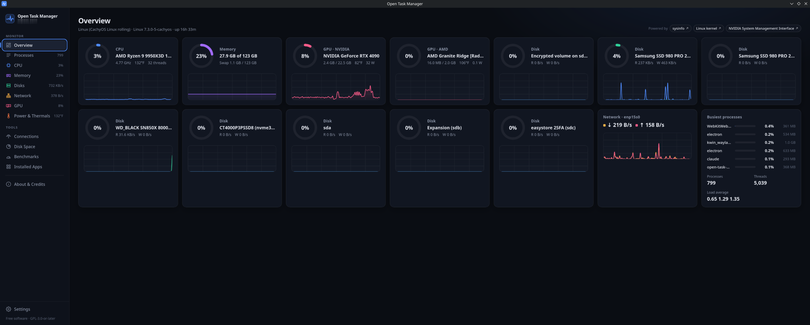
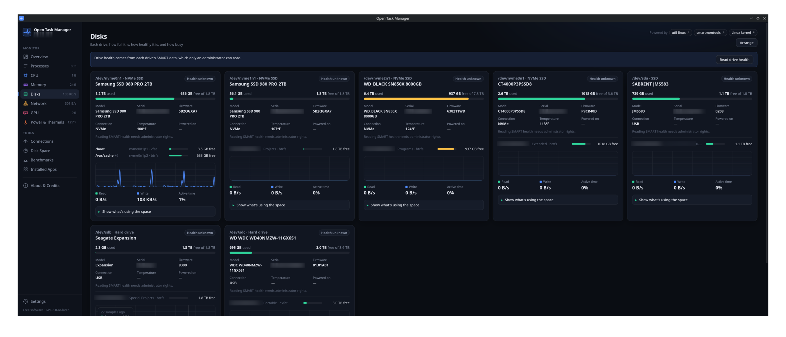
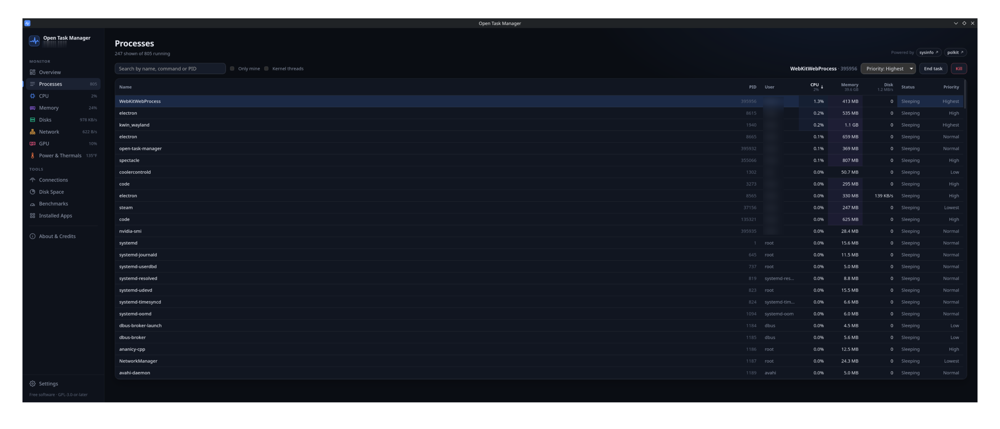
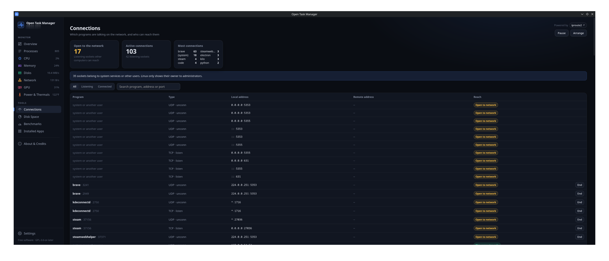
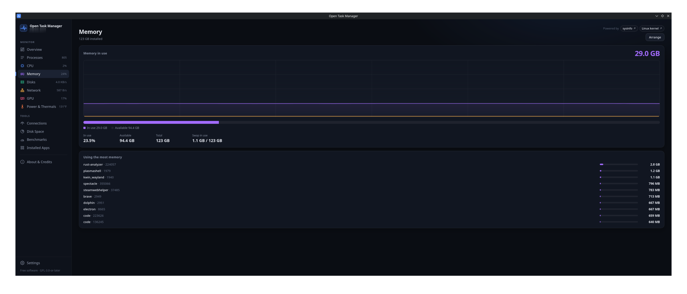
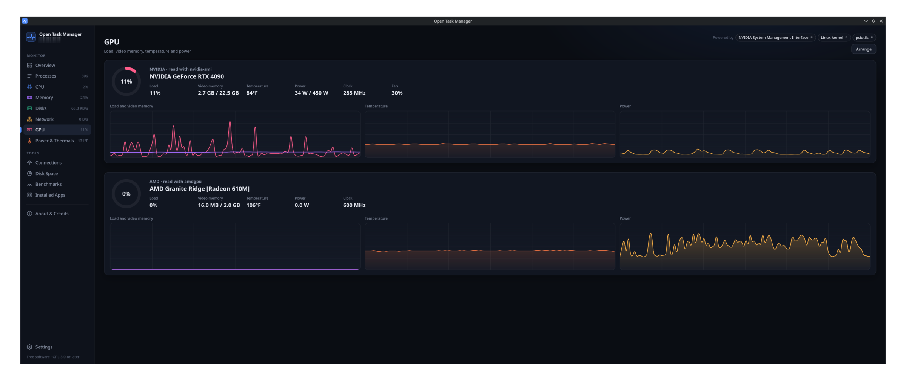

**A friend of mine was telling me how he was going to pay for an app someone else built so he could find all the system information he wanted (Surprise! Looking at the code it was built by AI).  I explained to him all of the tools are freely available already, but he felt it was too much work to look through them all. So I told him I could easily work with AI to build the interface and it would cost him nothing. So for those of you that needed it, here is Open Task Manager, and thank you to Claude.ai for making this a morning project instead of a week long headache. Enjoy!**

# Open Task Manager

A free task manager for Linux. It brings together the open source tools your
system already has in one window, with live graphs.

- **Overview**: CPU, memory, every GPU, every drive and every network interface at a glance
- **Slowdown check**: what could be making your computer slow right now (programs waiting on the processor, memory or disks, swapping, hogs, full or failing drives, heat, slow start-up), each explained, some with a fix
- **History**: read back what the app recorded while you weren't watching, a day or part of one, with each line's average and peak; compare two days, such as before and after a change
- **Pause the graphs**: click any graph to freeze every graph on the page at that moment, then step through time with the arrow keys
- **Processes**: sortable, searchable; end, kill or change priority (asks for your password through polkit when a process belongs to someone else)
- **CPU, Memory, Disks, Network, GPU**: live graphs and details; per-thread CPU graphs; NVIDIA through `nvidia-smi`, AMD through the amdgpu driver
- **Disks**: a card per drive with model, space, temperature and SMART health, and a folder-by-folder look at what fills it; each drive's firmware, updates from fwupd, known bad versions, and Western Digital updates with nvme-cli
- **Network**: which programs use each interface, busiest first; flags programs that no installed package accounts for; internet speed test
- **Power & Thermals**: every sensor lm-sensors can see, plus GPU power and CPU power (RAPL, needs root)
- **Connections**: which programs hold which sockets, and which ones other computers can reach
- **Disk Space**: a fast, parallel scan in the spirit of ncdu and Filelight; browse folders, largest files and space by file type
- **Benchmarks**: CPU and memory built in; disk (fio), graphics (glmark2) and internet (LibreSpeed)
- **Installed Apps**: pacman, dpkg, rpm and Flatpak packages by size
- **Startup**: everything that starts with the computer or when you log in (autostart apps, your services, system services, @reboot crontab lines) in one list, each with a switch, how long it held up start-up and the memory it uses now
- **Security audit**: runs [Lynis](https://github.com/CISOfy/lynis) and explains each finding; safe fixes come with a button and can be undone, and findings best left alone on a desktop say why
- **System tray**: keeps running, and logging, with the window closed; can start in the tray at login
- **Desktop widgets**: a see-through panel with the readings you pick, and a [readings feed](docs/readings-feed.md) so Plasma widgets, GNOME extensions or conky can show them too
- **Plugins**: pages other people write, loaded from a folder once you approve them; see [writing a plugin](docs/plugins.md)
- **Updates**: tells you when a new version is out; installs it on request or automatically (signed updates for the AppImage, .deb and .rpm)
- **Settings**: graph style, units, start page, start at login, logging chosen hardware to CSV files, and switching off pages you don't use (their readings stop too, unless a widget or the log still uses them)



<details>
<summary>More screenshots</summary>

**Disks**: each drive's model, space, temperature and health


**Processes**: sort, search, end or change priority


**Connections**: which programs are on the network, and who can reach them


**Memory**


**GPU**: NVIDIA and AMD side by side


</details>

No account, no telemetry and no paid tier. The app contacts the internet only
when you run the internet speed test or check for drive firmware, and, if you
agree to it, to ask GitHub once a day whether a newer version is out.

## Install

Download the package for your system from the
[latest release](https://github.com/RJCogburn/open-task-manager/releases/latest).
Most PCs need the `amd64` / `x86_64` files; `arm64` / `aarch64` files are for
ARM computers.

**Ubuntu, Debian, Linux Mint, Pop!_OS**: the `.deb` file

```sh
sudo apt install ./Open.Task.Manager_*_amd64.deb
```

**Fedora, openSUSE**: the `.rpm` file

```sh
sudo dnf install ./Open.Task.Manager-*.x86_64.rpm      # Fedora
sudo zypper install ./Open.Task.Manager-*.x86_64.rpm   # openSUSE
```

**Any other distribution**: the `.AppImage` file. It runs without installing:

```sh
chmod +x Open.Task.Manager_*_amd64.AppImage
./Open.Task.Manager_*_amd64.AppImage
```

**Arch, CachyOS, Manjaro**: build the package with the PKGBUILD, which adds a
launcher entry and icons:

```sh
git clone https://github.com/RJCogburn/open-task-manager.git
cd open-task-manager/packaging/arch
makepkg -si
```

The packages need Ubuntu 22.04, Debian 12, Fedora 36 or newer.

Flatpak and Snap aren't offered: their sandbox hides other programs'
processes, which a task manager needs to see.

## Updates

The app tells you when a new version is out, and Settings → Updates can check
daily and install updates by themselves. The AppImage, `.deb` and `.rpm` update
themselves; the packages ask for your password. Updates are signed, and the app
refuses any that aren't.

If you built the Arch package, update by building it again: in your clone, run
`git pull`, then `makepkg -si` in `packaging/arch`.

## Optional tools

Everything works without these. A few features use them when they're
installed, and when one is missing, the page that needs it offers to install
it with your package manager (asking for your password first).

| Feature | Needs |
|---|---|
| Temperatures, fans, voltages | `lm_sensors` (`lm-sensors` on Debian and Ubuntu) |
| Drive health | `smartmontools` |
| NVIDIA graphics cards | the NVIDIA driver (`nvidia-smi`) |
| Disk benchmark | `fio` |
| Graphics benchmark | `glmark2` |
| Security audit | `lynis` |
| Drive firmware updates | `fwupd`; `nvme-cli` for Western Digital and SanDisk drives |

The network and drive pages also use `iproute2`, `util-linux` and `curl`, which
almost every system already has.

- Arch: `sudo pacman -S lm_sensors smartmontools fio glmark2`
- Debian, Ubuntu: `sudo apt install lm-sensors smartmontools fio glmark2`
- Fedora: `sudo dnf install lm_sensors smartmontools fio glmark2`

## Building from source

Needs Rust and Node.js, plus Tauri's
[Linux prerequisites](https://tauri.app/start/prerequisites/#linux).

```sh
git clone https://github.com/RJCogburn/open-task-manager.git
cd open-task-manager
npm install
npm run tauri dev      # run in development
npm run tauri build    # build .deb, .rpm and AppImage packages
```

In VS Code, open `open-task-manager.code-workspace`. It has tasks to run the
app, build packages and run all the checks (Ctrl+Shift+B).

To add a tool of your own, see [CONTRIBUTING.md](CONTRIBUTING.md).

### Smaller builds

Every tool with a Rust side can be left out of a build: `benchmarks`,
`connections`, `disk-space`, `disks`, `installed-apps`, `network`, `processes`,
`security-audit`, `sensors`, `slowdown` and `startup-apps`. CPU, Memory, GPU,
Overview and History are always in. Name the tools to keep, and the pages of
the rest are left out too:

```sh
npm run tauri build -- --features processes,disks,sensors -- --no-default-features
```

Packagers can use this to drop tools that rely on programs their distribution
doesn't ship. Users of a full build can switch pages off in Settings instead.

### Making a release

1. Set the new version in `package.json`, `src-tauri/Cargo.toml` and
   `src-tauri/tauri.conf.json`, then run `npm install` and `cargo build` in
   `src-tauri` so the lock files follow.
2. Commit, tag and push, for example
   `git tag v0.81.0 && git push origin main v0.81.0`.
3. GitHub Actions builds the `.deb`, `.rpm` and AppImage for x86_64 and ARM on
   Ubuntu 22.04, signs the update files with the `TAURI_SIGNING_PRIVATE_KEY`
   secret, and uploads everything to a draft release.
4. Publish the draft. On the Releases page, click the pencil icon on the draft
   (it may be under "…"). Check that the tag field shows the new version, like
   `v0.81.0`, not `untagged-…`; otherwise the updater's download links break.
   Add the notes, then click **Publish release** at the bottom. Don't use
   "Draft a new release", which makes a second, empty release.

## How much load it adds

The figures below were measured on a Ryzen 9 9950X3D with the window open,
updating once a second, over 20 seconds, with the release build. The window was
drawn in software in a headless test session, so on a real desktop with GPU
drawing the interface share should be lower.

| Page | App process | Interface (WebKit) | Total, as share of one core |
|---|---|---|---|
| Overview | 1.4% | 3.0% | ~4.6% |
| CPU | 1.2% | 2.2% | ~3.5% |
| Processes | 1.5% | 6.2% | ~8% |

On a 32-thread CPU, 4.6% of one core is about 0.15% of the whole processor.
Slower update speeds (2 s or 5 s, in Settings) cut this further. Pages you are
not looking at do no work, apart from the shared once-a-second sample that
keeps the graph history filled.

## License

Copyright © 2026 Open Task Manager contributors.

Open Task Manager is free software: you can redistribute it and/or modify it
under the terms of the GNU General Public License as published by the Free
Software Foundation, either version 3 of the License, or (at your option) any
later version. See [LICENSE](LICENSE).

It is built on many other projects; see [CREDITS.md](CREDITS.md).
